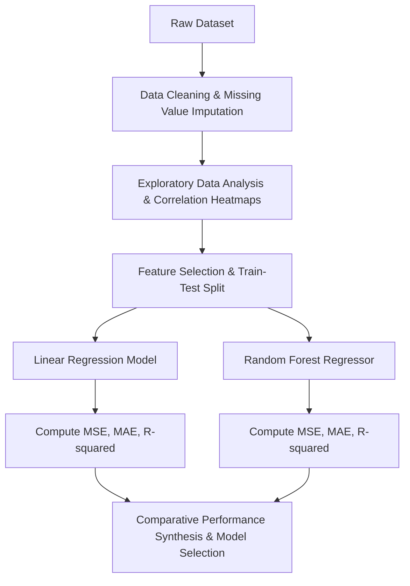

<p align="center">
  
</p>

<p align="center">
  
  
  
  
  
</p>

---

## Executive Summary / Overview
### Problem Statement & Context
Predictive modeling in real-world environments requires navigating noisy multidimensional feature spaces, collinearity, and non-linear interactions. Selecting the right predictive architecture requires disciplined exploratory analysis, disciplined cross-validation, and benchmarking linear estimators against non-linear ensemble methods.

### Solution Overview
This repository implements an end-to-end **Data Science & Statistical Machine Learning Pipeline** (`IDS & SDS PROJECT.ipynb`). The pipeline encompasses robust exploratory data analysis, correlation matrix heatmaps, feature encoding, train-test partitioning, and comparative benchmarking between **Ordinary Least Squares (OLS) Linear Regression** and **Random Forest Regressors** using standard regression evaluation metrics (R-squared, MSE, MAE).

---

## Interactive Table of Contents
- [Executive Summary / Overview](#executive-summary--overview)
- [Key Features & Capabilities](#key-features--capabilities)
- [System Architecture / Pipeline](#system-architecture--pipeline)
- [Tech Stack Breakdown](#tech-stack-breakdown)
- [Reproducible Quickstart & Setup](#reproducible-quickstart--setup)
- [Project Directory Layout](#project-directory-layout)
- [Author & Contributions](#author--contributions)

---

## Key Features & Capabilities
- **Deep Statistical EDA:** Comprehensive bivariate and multivariate analysis using Seaborn distribution plots, pairplots, and Pearson correlation heatmaps.
- **Multi-Model Regression Benchmarking:** Quantitative comparison of parametric Linear Regression against non-parametric ensemble Random Forest estimators.
- **Strict Performance Metrics:** Comprehensive evaluation including Mean Squared Error (MSE), Root Mean Squared Error (RMSE), Mean Absolute Error (MAE), and Coefficient of Determination (R^2).
- **Predictive Residual Analysis:** Examination of error distributions to identify heteroscedasticity and non-linear pattern capture.

---

## System Architecture / Pipeline


---

## Tech Stack Breakdown
| Layer | Technology | Purpose |
| :--- | :--- | :--- |
| **Languages** | Python 3.10+ | Primary statistical programming language |
| **Libraries** | Scikit-Learn, NumPy, Pandas | Estimators, tensor computation, DataFrame operations |
| **Tools** | Matplotlib, Seaborn, Jupyter Notebook | Statistical visualization and correlation heatmaps |
| **Architecture** | Supervised Regression & Ensembles | Cross-validated predictive modeling pipeline |

---

## Reproducible Quickstart & Setup
```bash
# 1. Clone repository
git clone https://github.com/suryateja-155/DATA-SCIENCE-PROJECT.git
cd DATA-SCIENCE-PROJECT

# 2. Virtual environment setup
python -m venv venv
.\venv\Scripts\activate   # On Windows

# 3. Install ML dependencies
pip install numpy pandas matplotlib seaborn scikit-learn notebook

# 4. Run the predictive pipeline
jupyter notebook "IDS & SDS PROJECT.ipynb"
```

---

## Project Directory Layout
```text
DATA-SCIENCE-PROJECT/
├── IDS & SDS PROJECT.ipynb   # Comprehensive data science & machine learning notebook (774 KB)
└── README.md                # System documentation and model evaluation report
```

---

## Author & Contributions

**Gettupalli Surya Teja**  
- GitHub Profile: [@suryateja-155](https://github.com/suryateja-155)  
- Portfolio Index: [Gettupalli-Surya-Teja](https://github.com/suryateja-155/Gettupalli-Surya-Teja)

Contributions, issue reports, and feedback are always welcome! Feel free to open an issue or pull request.

<p align="center">
  
</p>
